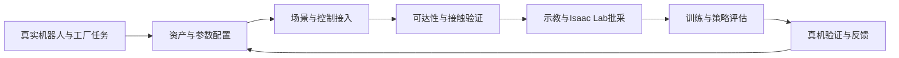

# RouteManager

**面向自研机器人的一站式工厂仿真配置、可达性验证与数据采集平台。**

以 **Isaac Sim 6.2 + Isaac Lab 3.0** 为底座，整合机器人、工厂资产、控制接口、遥操作与第三方工具，逐步打通 **Real → Sim → Real**。当前围绕RM65双臂轮式人形、CTAG2F120夹爪，以及电柜按钮、旋钮、压板和阀门任务建设。

**[使用手册](docs/README.md) · [项目现状与TODO](TODO.md) · [外部资产库](third_party/README.md)**

## 项目主线



平台提供统一HTTP执行器，连接模型导入、关节/夹爪/底盘控制、ROS2、Pico VR、SimPeople与SimScene。桌面交互用于配置和验证；Isaac Lab独立批处理进程用于并行采集。

已验证内容包括固定台架阀门真实接触、部分电柜人形操作、33类机构任务的并行采集、单人巡检与静态场景工具接入。**机构力驱动数据、人形接触数据、几何可达和真机验收分别记录**；完整策略回真机闭环仍在建设。具体范围、证据和下一步统一维护在TODO中。

## 开始使用

在已安装Isaac Sim 6.2的机器上，从项目根运行：

```bash
# 1. 接入自己的外部资产库；不会复制或上传模型
python3 scripts/link_asset_library.py link --root /path/to/vla_data
python3 scripts/link_asset_library.py status

# 2. 新部署参照config.example.json准备config.json；已有部署保留原配置
#    核对robot.presets里的URDF/USD路径、模型身份和地面高度

# 3. 启动GUI服务；非本机环境用ISAAC_PYTHON指定解释器
./scripts/run.sh

# 4. 在另一个终端检查服务；空会话才加载一次机器人
curl -s http://127.0.0.1:18765/health
./scripts/load_scene.sh
```

本机资产库为`/home/jy/datasets/vla_data`，链接入口为`third_party/vla_assets`。本机Isaac解释器为`/home/jy/micromamba/envs/isaacsim6.0/bin/python`，目录沿用旧名，实际安装 **6.2 / Python 3.12**。

首次启动可能需1～3分钟。已有机器人时先读状态，避免重复加载。相机按需启用。使用手册集中提供资产接入、任务验证、批量采集和排错步骤，可在一页内顺序阅读。

## 开发与维护

```text
核心Python模块 / ros2_bridge/  仿真、任务队列与机器人控制
scripts/                     任务、采集、转换和诊断入口
tests/                       不启动Kit的离线回归
assets/                      参数、来源清单与构建说明
third_party/                 外部库登记与本机资产链接
docs/                        使用手册与专题参考
memory/                      有日期和验证范围的工程记录
outputs/                     本机采集和验收产物，Git忽略
```

```bash
env -u PYTHONPATH -u LD_LIBRARY_PATH /path/to/isaac/python \
  -m unittest discover -s tests -p 'test_*.py'
```

新增功能同时更新TODO中的状态、验收条件和证据；常用操作进入使用手册，历史试验保留原日期。Agent约束统一在[AGENTS.md](AGENTS.md)。项目代码采用[MIT许可证](LICENSE)，外部工具和资产遵循各自来源与许可。
