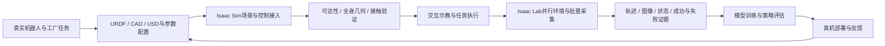

# RouteManager

**面向自研机器人的一站式工厂仿真配置、任务验证与数据采集平台。**

RouteManager以 **Isaac Sim 6.2** 为运行底座，整合机器人描述、CAD/USD工厂资产、ROS2/HTTP控制、VR遥操作、人物活动与Isaac Lab批量环境，服务于 **Real → Sim → Real**：把真实机器人与工厂任务带进仿真，验证可达性和任务执行，生成可追溯数据，再支持策略回到真机验证。

当前重点是RM65六轴双臂人形整机、CTAG2F120夹爪、四轮八驱底盘，以及电柜按钮、旋钮、压板和阀门任务。完整真机闭环仍需实物标定、训练和部署验收。

## 工作流



每个阶段保存模型身份、参数、坐标、实际反馈与验证范围。参考参数、几何可达、机构受力数据和人形真实接触数据分别标记，便于判断哪些结果能进入后续训练或真机验证。

## 能做什么

| 能力 | 当前实现与入口 |
|---|---|
| 仿真配置与统一控制 | HTTP任务服务、URDF→USD导入、机器人预设、关节/夹爪/底盘控制；[HTTP接口](docs/HTTP接口.md) |
| 自研机器人接入 | RM65/CTAG2F120接口语义、软件mimic、模型身份与关节检查、ROS2契约；[ROS2接口](docs/ROS2接口_iasscsim_robot.md) |
| 工厂任务与交互 | 电柜机构、阀门真实接触转动、任务面板、运输收臂与接近工位；[任务导航](docs/README.md#任务与机器人验证) |
| 可达性与执行验证 | URDF FK/数值雅可比、连续IK、全身几何、驻车与接触门控；[阀门流程](docs/阀门手轮操作.md) |
| Isaac Lab批量采集 | 33个L3机构任务、并行环境、HDF5轨迹、可选RGB与独立数据验收；[批量采集](docs/IsaacLab电力柜批量采集.md) |
| VR与多方资源 | Pico/XRoboToolkit遥操作、SimPeople人物巡检、SimScene资产工具；[集成导航](docs/README.md#资源与外部集成) |
| 真机闭环基础 | ROS2控制/反馈契约和rm_driver桥接；硬件标定、策略迁移与完整闭环验收继续建设 |

### 已验证结果与范围

- **批采**：4环境、33个任务各2回合，66/66通过；另有2环境RGB与合作停止验证。当前数据为`fixture_effort`机构广义力控制，尚未包含人形手臂接触执行器。[数据契约](docs/IsaacLab电力柜批量采集.md)
- **接触操作**：固定底盘下完成多个阀门的夹持、转动、松爪和退出；实际转角、载荷、滑移及失败记录单独保留。[阀门验证](docs/其他阀门操作验证.md)
- **人物与场景工具**：单人两点巡检、取消停稳、与原地阀门动作并行通过；SimScene静态视觉层导入/移除及侵入拒绝通过。[SimPeople](docs/SimPeople_场景附着与单人巡检.md) · [SimScene](docs/SimScene_资产工具与当前场景接入.md)

这些是具体模型与场景的验收结果。实物力学标定、通用全身规划、人体物理接触、完整人形批量示教及策略回真机仍需继续验证。

## 环境

| 组件 | 要求 |
|---|---|
| 仿真运行时 | Isaac Sim **6.2**，本机Python 3.12 |
| 批量环境 | 与6.2配套的Isaac Lab **3.0** |
| 服务与工具 | fastapi、uvicorn；抓图需opencv，运动学工具需NumPy/SciPy |
| 可选能力 | ROS2、Pico/XRoboToolkit、SimPeople、SimScene及其对应资产/SDK |
| 资产 | 按部署机器准备自己的机器人、场景和机构；[资产管理](assets/README.md) |

本机运行时是`/home/jy/micromamba/envs/isaacsim6.0/bin/python`。目录名沿用旧名，安装内容已升级为6.2；不要切回已删除的5.1环境。其它机器按NVIDIA对应版本安装并设置`ISAAC_PYTHON`，不要用通用`pip install -U`覆盖Isaac配套依赖。

## 快速开始

### 1. 配置本机资产

新部署可从`config.example.json`建立`config.json`，替换`robot.presets`中的URDF/USD路径，并确认地面高度、实际关节命名、夹爪与相机配置。已有部署保留自己的`config.json`。

当前本机默认预设为`v3_ctag2f120_rm65`。旧七轴、六轴整机和单臂验证模型有不同运动学与姿态配置，加载前先核对模型身份。大型模型、CAD、生成USD和数据集不随源码打包，需要自己的资产或按来源清单恢复。

### 2. 启动HTTP仿真服务

```bash
./scripts/run.sh                         # GUI
HEADLESS=1 ./scripts/run.sh              # RouteManager无头模式
ISAAC_PYTHON=/path/to/isaac/python ./scripts/run.sh
```

`run.sh`隔离ROS Humble污染并前置Isaac自带ROS2库，首次加载可能需1～3分钟。RouteManager的`HEADLESS=1`与Isaac Lab启动方式不同：Lab 3.0需清除`DISPLAY`，其启动器不使用`--headless`。

### 3. 检查并加载机器人

```bash
curl -s http://127.0.0.1:18765/health       # IDLE表示就绪
./scripts/load_scene.sh                  # 地面 + config默认机器人
./scripts/load_scene.sh -n v3_ctag2f120_rm65_l2
./scripts/load_scene.sh -a /path/to/robot.urdf

curl -s -X POST http://127.0.0.1:18765/execute \
  -H 'Content-Type: application/json' -d '{"action":"get_joint_names"}'
```

同一会话只加载一次机器人，已有机器人时先读取状态。静态相机默认不自动注册，需要图像时再按任务启用。`bringup.sh`是旧VR演示流程，会重启服务并显式加载相机，不作为一般任务的默认入口。

## 任务与采集入口

### 桌面工位与可达性

```bash
python3 scripts/setup_cabinet_actions.py  # 已有工位重开面板；空服务按本机资产搭建
python3 scripts/valve_operation.py --help
python3 scripts/valve_operation.py capture --output outputs/valve/new_capture
python3 scripts/valve_operation.py plan --snapshot outputs/valve/new_capture/snapshot.json \
  --output outputs/valve/new_plan
```

离线plan使用本次真实snapshot，执行run前保留完整预检；工位、模型和末端几何须与现场匹配。参数和验收步骤见[阀门手轮操作](docs/阀门手轮操作.md)、[四轮八驱控制](docs/四轮八驱底盘控制.md)。

### Isaac Lab并行采集

```bash
./scripts/collect_l3_isaaclab.sh --num-envs 4 --episodes 2 \
  --tasks all --output outputs/l3_dataset/new_batch
./scripts/collect_l3_isaaclab.sh --num-envs 2 --episodes 1 --tasks button --rgb \
  --output outputs/l3_dataset/new_rgb_batch

/path/to/isaac/python scripts/validate_l3_dataset.py \
  outputs/l3_dataset/new_batch --require-all-tasks
```

批采使用独立Isaac Lab进程，不接管桌面RouteManager。每批新建输出目录，保存任务/资产来源、成功/失败与中断标记；`STOP`支持合作停止。240Hz控制子步与30Hz保存、RGB时间戳及字段详见[数据契约](docs/IsaacLab电力柜批量采集.md)。

### 资源集成

| 集成 | 在本项目中的作用与边界 |
|---|---|
| ROS2 | Isaac 6.2自带rclpy的进程内契约为优先路径；独立py3.10中继作兜底，两者不同时开 |
| Pico / XRoboToolkit | 交互式遥操作与后续示教入口，先验证真实输入，再验证映射和末端反馈 |
| SimPeople | 附着既有场景的原生人物活动；不以根平移/另写骨骼伪造行走 |
| SimScene | 资产发现、缓存、测量、保存方案和静态视觉层附着；当前适配不启用其独立仿真worker |

按[集成文档](docs/README.md#资源与外部集成)分别安装。人物/资产工具可沿用当前会话；Isaac Lab批采明确使用独立批处理进程。

## 仓库结构与验证

```text
main.py / sim_env.py       启动与Isaac扩展
robot_manager.py          机器人与场景action执行器
standalone_server.py       HTTP任务队列与主线程分发
arm_kin.py 等              FK、规划与夹爪模型
ros2_bridge/               ROS2契约和相机图
scripts/                   运行、任务、资产构建、诊断与原生验收入口
tests/                     离线unittest回归
assets/                    小型来源文件、清单、参数与获取说明
docs/                      人类操作与数据契约文档
memory/                    项目实测结论与失败记录索引
outputs/                   本机运行、采集与证据；不上传
```

```bash
# 离线回归，不启动Kit；部分模型回归需要本机URDF/标定输入
env -u PYTHONPATH -u LD_LIBRARY_PATH /path/to/isaac/python \
  -m unittest discover -s tests -p 'test_*.py'
python3 standalone_server.py --demo      # 假执行器，仅验证HTTP框架
```

离线回归、仿真反馈、完整任务与真机验证分别验收；发布训练数据前检查记录的执行模式与失败标记。[目录指南](docs/项目目录与文件管理.md)说明代码和产物管理，Agent约束统一在[AGENTS.md](AGENTS.md)，操作说明从[文档导航](docs/README.md)进入。

## 下一步：完善Real → Sim → Real

1. 建立自研机器人/工厂资产的版本、坐标和实物参数标定闭环。
2. 把已验证接触任务接入统一任务契约与Isaac Lab人形并行执行器。
3. 扩展同步传感器数据、场景/参数随机化、任务覆盖与数据质量审计。
4. 在固定验收条件下训练、评估与回放策略，再接真机执行和反馈校正。

代码沿用[MIT许可证](LICENSE)。第三方工具与机器人/工厂资产遵循各自许可证，来源和分发范围见[资产说明](assets/README.md)。
